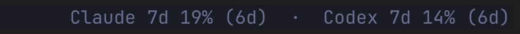
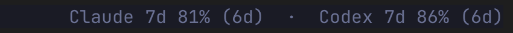
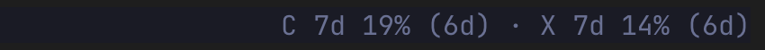
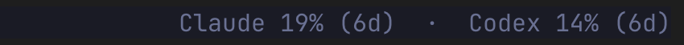
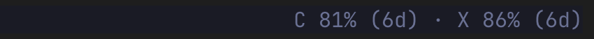

# QuotaRibbon

A [Herdr](https://herdr.dev) plugin that shows your Claude Code and Codex subscription usage
on the right side of the Herdr tab bar:

```
Claude 7d 81% (6d)  ·  Codex 7d 99% (6d)
```

By default the percentage is how much of the window you have **used**. Set `display.mode` to
`"remaining"` in [settings](#settings) to show what is left instead (`Claude 7d 19% (6d)`). The
part in parentheses is the time left until the window resets; set `display.show_reset` to
`false` to hide it. Windows are labelled by length (`5h`, `7d`); set `display.window_labels` to
`false` to drop the label when only one window shows. A window the provider does not report is
not shown at all; if it reports none, you see `Claude --`.

**Features (v0.1.0):** usage on the right side of the tab bar · show/hide each service ·
refresh now · refresh interval picker · used or remaining display · compact format · reset countdown ·
diagnostics · guided setup and detach.

**macOS only.** Tested on macOS 26.6.2 (Apple silicon; Intel Macs not tested) with Herdr 0.9.5,
Claude Code 2.1.316 and 2.1.318, codex-cli 0.166.0, and Python 3.11, 3.12 and 3.14.

## Requirements

- macOS and Herdr 0.9.5 or newer.
- Python 3.11 or newer at a real path (not a pyenv/asdf shim; macOS's `/usr/bin/python3` is
  too old). No packages to install.
- Claude Code and/or Codex, logged in with a subscription (Claude.ai / ChatGPT). A service
  using an API key stays hidden.
- Herdr's integration for each: `herdr integration install claude` / `herdr integration install codex`.

## Install

```sh
herdr plugin install fluzzy/herdr-quotaribbon
# or, from a local checkout: herdr plugin link /path/to/herdr-quotaribbon
```

Then run the action **QuotaRibbon: Set up tab bar**
(`herdr plugin action invoke setup --plugin fluzzy.herdr-quotaribbon`). It previews the change
and asks before writing. It adds one entry to `ui.tab_bar_right` in your Herdr config, backs up
the old file (the 5 newest backups are kept), and offers to reload the config. Nothing else is
changed.

From a terminal, run this in the plugin root (`plugin_root` in `herdr plugin list --json`):
`bin/quotaribbon setup --herdr-config ~/.config/herdr/config.toml --dry-run` to preview, and
`--yes` instead of `--dry-run` to apply. If setup rejects your Python, prefix the command with
`QUOTARIBBON_PYTHON=/path/to/python3.12`.

**After updating** (`herdr plugin update fluzzy.herdr-quotaribbon`, or pulling a linked
checkout), run **QuotaRibbon: Set up tab bar** again. This refreshes the installed tab-bar
launcher and leaves your config alone. If setup reports an outdated entry, run **QuotaRibbon:
Remove from tab bar** first.

## What runs on your machine

- **At Herdr server start:** a startup hook runs once, resets QuotaRibbon's per-server
  state, and exits.
- **Every 5 seconds (after setup):** Herdr runs the tab-bar command. It reads QuotaRibbon's local
  files and starts no CLI. When a refresh is due (every 2 minutes by default), it asks Herdr to run
  the **Refresh** action.
- **Refresh:** runs the official CLIs, `claude auth status --json` and `claude -p` (stream-json), and
  `codex app-server`, to read usage without sending a prompt.
- Every command is listed in `herdr-plugin.toml`.

## Usage

| Action | Id |
| --- | --- |
| QuotaRibbon: Show / Hide Claude limits | `claude-on` / `claude-off` |
| QuotaRibbon: Show / Hide Codex limits | `codex-on` / `codex-off` |
| QuotaRibbon: Refresh limits | `refresh` |
| QuotaRibbon: Set refresh interval | `interval` |
| QuotaRibbon: Diagnostics | `diagnostics` |
| QuotaRibbon: Set up tab bar / Remove from tab bar | `setup` / `detach` |

- Hiding a service stops its usage requests; it does not log you out.
- **Refresh** skips the retry wait after a failed refresh. It still honours a wait the provider
  asks for, and runs at most once a minute.
- **Set refresh interval** offers 1, 2, 5 or 10 minutes. From a terminal:
  `bin/quotaribbon interval 300` (60–900 seconds).

To bind an action to a key, add this to `~/.config/herdr/config.toml`:

```toml
[[keys.command]]
key = "prefix+u"
type = "plugin_action"
command = "fluzzy.herdr-quotaribbon.refresh"
```

See [Troubleshooting](#troubleshooting) for what `…`, `--`, `[stale …]` and `[failing …]` mean.

## Settings

Most people never need to edit anything. The show/hide and **Set refresh interval** actions
change the settings for you. The display options below have no action; you edit a file.

### How to change a setting

1. Find the folder: run `herdr plugin config-dir fluzzy.herdr-quotaribbon`. By default it is
   `~/.config/herdr/plugins/config/fluzzy.herdr-quotaribbon/`.
2. Open `settings.json` in that folder. Setup writes a default one. If it is missing, create it
   and paste the [example below](#example).
3. Save. The change shows up within a few seconds: the tab bar re-reads the file every time it
   updates. No restart or config reload is needed.
4. To check, run **QuotaRibbon: Diagnostics**. Under `[settings]` you should see `valid: yes`
   and `source: file`.

If the file has a mistake, QuotaRibbon keeps using the last valid settings (if there were none,
the line goes blank). **Diagnostics** shows `valid: no` and names the bad key, for example
`settings.display.mode: must be "used" or "remaining"`. Unknown keys count as mistakes. The
actions will not edit an invalid file; fix it, or delete it to go back to the defaults.

### Display options

All four go under `"display"` and can be combined.

| Option | Values | Default | Example |
| --- | --- | --- | --- |
| `mode` | `"used"`, `"remaining"` | `"used"` | `Claude 7d 18% (6d)` → `Claude 7d 82% (6d)` |
| `format` | `"full"`, `"compact"` | `"full"` | `Claude 5h 32% (3h) \| 7d 68% (6d)` → `C 5h 32% (3h) 7d 68% (6d)` |
| `show_reset` | `true`, `false` | `true` | `Claude 7d 18% (6d)` → `Claude 7d 18%` |
| `window_labels` | `true`, `false` | `true` | `Claude 7d 18% (6d)` → `Claude 18% (6d)` |

- **mode:** remaining is `100 − used`, rounded down.
- **format:** compact uses initials (`C`, `X`) and tighter separators; window labels stay. Use
  it when the tab row is narrow, because Herdr hides the whole status area when it does not fit.
- **show_reset:** shows the time left until each window resets, rounded down: whole days from
  one day up (`6d`, `1d`), hours and minutes below that (`5h 12m`; just `5h` when the minutes are
  zero), and minutes under an hour (`42m`; never below `1m`). It shows even when the value is
  `--`. No suffix when the reset time is unknown, already past, or more than the window's length
  plus an hour away. Set it to `false` to hide the countdown.
- **window_labels:** set to `false` to drop the `5h` / `7d` label when a provider shows only
  one window. A provider with two windows keeps its labels, so the numbers stay clear.

With `remaining` and `compact`, `Claude 7d 18% (6d)` becomes `C 7d 82% (6d)`; add
`"window_labels": false` and it becomes `C 82% (6d)`; add `"show_reset": false` as well and it
becomes `C 82%`.

Here is how each one looks at the right end of the tab bar:

| Setting | Tab bar |
| --- | --- |
| Default (`{}`) |  |
| `"show_reset": false` |  |
| `"mode": "remaining"` |  |
| `"format": "compact"` |  |
| `"window_labels": false` |  |
| `remaining`, `compact` and no window labels |  |

### Refresh interval

The easy way: run **QuotaRibbon: Set refresh interval** and pick 1, 2, 5 or 10 minutes.

Or set `refresh.interval_seconds` in the file: default 120, allowed 60–900. It takes effect at
the next tab-bar update. The interval alone is enough; the stale and hide times follow it.

Advanced: `stale_after_seconds` and `hide_values_after_seconds` are optional. Left out, they are
stale = max(300, 2 × interval) and hide = min(3600, max(900, 3 × interval)); `600` gives
`1200` / `1800`. If you set them, stale must be at least twice the interval, and hide must be
above stale and at most 3600. If you set only stale and it is not below the derived hide, hide
becomes stale + interval (at most 3600). A file with the old defaults `300` / `900` is treated as
if they were left out.

### Example

A complete `settings.json` with remaining, compact, the reset countdown off and a 5-minute refresh:

```json
{
  "schema_version": 1,
  "providers": { "claude": { "enabled": true }, "codex": { "enabled": true } },
  "display": { "mode": "remaining", "format": "compact", "show_reset": false },
  "refresh": { "interval_seconds": 300 }
}
```

`schema_version` and both `providers` entries are required; `display` and `refresh` are
optional. Each provider also takes an optional `binary` and `profile_dir` (absolute paths). By
default the CLI is found on `PATH`, and the profiles are `~/.claude` and `~/.codex`.

## Troubleshooting

Start with **QuotaRibbon: Diagnostics**. It shows the current tab-bar line, why a service is
hidden, and your `ui` settings.

- **Nothing in the tab bar.** Run **QuotaRibbon: Set up tab bar** if you have not. Herdr hides
  the whole status area when the tab row is too narrow (try `"format": "compact"`), and when
  `ui.hide_tab_bar_when_single_tab = true` and there is only one tab.
- **One service missing.** It is hidden, logged out, on an API key, or not set up in Herdr
  (`herdr integration install claude` / `codex`). Diagnostics names the reason.
- **`Claude …`**: checking the connection or fetching for the first time. Wait for the next
  refresh.
- **`--`**: no usable value right now. A single window shows `--` just after it resets.
- **`[stale 4m]`**: the value is 4 minutes old, or a later refresh failed.
- **`Claude -- [failing 12m]`**: the last successful refresh was 12 minutes ago, every refresh
  since has failed, and the old values are now hidden.
- **Setup rejects your Python.** Point it at Python 3.11 or newer at a real path:
  `QUOTARIBBON_PYTHON=/path/to/python3.12`. A pyenv/asdf shim is refused.
- **After updating the plugin**, run **QuotaRibbon: Set up tab bar** again (see
  [Install](#install)).

## Development

Requires Python 3.11 or newer; the tests use the standard library only.

```sh
python3 -m unittest discover -s tests -t .
```

To try a local checkout in Herdr, link it with `herdr plugin link` (see [Install](#install)).

## Feedback

Report bugs and ideas at https://github.com/fluzzy/herdr-quotaribbon/issues.

## Privacy

- Usage comes from the official `claude` and `codex` CLIs. No prompt is sent and no model
  turn starts. Those CLIs handle their own sign-in and network traffic, just as when you run
  them yourself; QuotaRibbon itself sends nothing anywhere.
- Tokens and credential files are never read. No emails or tokens are stored.
- Files are written only to the plugin's config and state directories, with one exception:
  setup and detach edit `~/.config/herdr/config.toml`, and only after you confirm.
- Before each such edit, a private copy (readable only by you) of the whole Herdr
  `config.toml` is saved under the plugin's state directory, in `backups/`. Up to 5 copies are
  kept. They hold whatever your config held, so delete them if that matters to you.

## Uninstall

1. Run **QuotaRibbon: Remove from tab bar**.
2. Run `herdr plugin uninstall fluzzy.herdr-quotaribbon`, or
   `herdr plugin unlink fluzzy.herdr-quotaribbon` for a linked checkout.
3. Optional: delete QuotaRibbon's files, including the config backups:
   `rm -rf ~/.config/herdr/plugins/config/fluzzy.herdr-quotaribbon ~/.local/state/herdr/plugins/fluzzy.herdr-quotaribbon`

## Limitations

- macOS only. One profile per service.
- Usage is fetched while any Herdr server runs, even with no client attached.
- Claude usage comes from an experimental Claude Code interface. A Claude Code update can
  break it, and Claude then shows `--`. If admin-managed Claude Code settings exist, Claude
  also shows `--`.
- Herdr hides the line when the tab row is too narrow, or when
  `ui.hide_tab_bar_when_single_tab = true` and there is only one tab.

## Disclaimer

QuotaRibbon is an independent project. It is not affiliated with or endorsed by Anthropic, OpenAI
or the Herdr project. Claude, Claude Code, Codex and ChatGPT are trademarks of their respective
owners.

## License

MIT. See [LICENSE](LICENSE).
